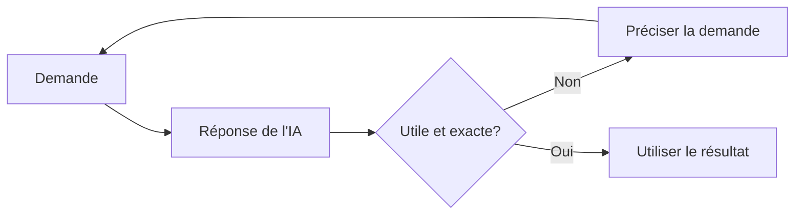

# Module 1 — Premiers pas

## Objectifs

- Comprendre ce qu'est un assistant d'IA conversationnel et ce qu'il ne fait pas.
- Écrire une première demande claire et l'améliorer par itération.
- Repérer une réponse inventée ou douteuse.

::: info Contenu à venir
Cette page sert de point de départ. Le contenu du module sera ajouté ici.
:::

