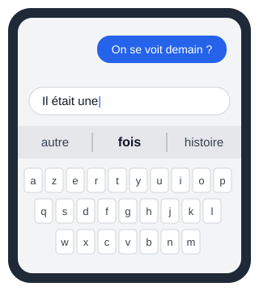

<script setup>
const quelElementManque = [
  {
    question: "Quel élément manque à cette demande ?",
    code: "Dans Jumelo, ajoute un filtre par voie à la liste des offres pour que Geneviève trouve vite les offres de réseaux. Pas de code-behind, pas de nouveau paquet. Le projet compile et un test vérifie le filtre.",
    choix: ["Objectif", "Contexte", "Contraintes", "Critères de réussite"],
    bonne: 1,
    explication: "L'agent ne sait pas où est la liste, ni que le projet utilise des classes MVVM maison. Il va chercher, ou deviner.",
  },
  {
    question: "Et à celle-ci ?",
    code: "Le projet est en WPF MVVM avec nos classes maison ; la liste des offres est dans OffresViewModel. N'ajoute aucun paquet. Tous les tests doivent passer.",
    choix: ["Objectif", "Contexte", "Contraintes", "Critères de réussite"],
    bonne: 0,
    explication: "Tout le contexte est là, mais rien ne dit ce qu'il faut faire ni pourquoi.",
  },
  {
    question: "Et à celle-ci ?",
    code: "Ajoute un filtre par voie dans OffresViewModel (WPF MVVM, classes maison) pour que Geneviève trouve vite les offres de réseaux. Un test du ViewModel doit vérifier le filtre.",
    choix: ["Objectif", "Contexte", "Contraintes", "Critères de réussite"],
    bonne: 2,
    explication: "Rien n'interdit le code-behind ni l'ajout d'un paquet. L'agent choisira le chemin le plus court, pas forcément le vôtre.",
  },
  {
    question: "Et à la dernière ?",
    code: "Ajoute un filtre par voie dans OffresViewModel (WPF MVVM, classes maison) pour que Geneviève trouve vite les offres de réseaux. Pas de code-behind, pas de nouveau paquet.",
    choix: ["Objectif", "Contexte", "Contraintes", "Critères de réussite"],
    bonne: 3,
    explication: "Comment l'agent sait-il qu'il a fini ? Sans critère vérifiable (compilation, tests), il s'arrête quand le code « a l'air bon ».",
  },
];

const billetDeSortie = [
  {
    question: "Vous posez deux fois exactement la même question à Copilot et obtenez deux réponses différentes. Pourquoi ?",
    choix: [
      "Copilot a appris de votre première question.",
      "Le modèle tire chaque token parmi plusieurs suites probables.",
      "Le serveur était surchargé la première fois.",
      "La deuxième réponse corrige la première.",
    ],
    bonne: 1,
    explication: "La génération est un tirage, token par token. Deux tirages donnent rarement exactement le même texte.",
  },
  {
    question: "Copilot vous propose, avec assurance, etudiants.RemoveWhere(...) sur une List<Etudiant>. Que s'est-il passé ?",
    choix: [
      "Copilot a vérifié dans la documentation de .NET.",
      "La méthode vient d'être ajoutée dans .NET 10.",
      "Le modèle a produit une suite plausible, sans rien vérifier.",
      "Il manque une directive using.",
    ],
    bonne: 2,
    explication: "RemoveWhere existe sur HashSet<T>. Pour le modèle, c'est une suite probable ; seul le compilateur, ou vous, peut vérifier.",
  },
  {
    question: "Après deux heures dans la même conversation, l'agent ne respecte plus une consigne donnée au début. L'explication la plus probable ?",
    choix: [
      "La consigne est sortie de la fenêtre de contexte, ou s'est noyée dans tout le reste.",
      "Le modèle se fatigue après un certain temps.",
      "Une consigne ne vaut que pour la réponse suivante.",
      "Votre licence Copilot a atteint sa limite.",
    ],
    bonne: 0,
    explication: "Tout ce que le modèle « sait » est dans la fenêtre. Une conversation neuve, avec un fichier d'instructions, règle souvent le problème (séance 2).",
  },
  {
    question: "Qu'est-ce qui distingue un agent d'un chat ?",
    choix: [
      "Il utilise un modèle plus gros.",
      "Il ne se trompe pas.",
      "Il utilise des outils, en boucle, jusqu'à atteindre l'objectif.",
      "Il fonctionne sans connexion Internet.",
    ],
    bonne: 2,
    explication: "Agent = modèle + outils + boucle. Le modèle peut être le même que dans le chat.",
  },
  {
    question: "L'agent annonce : « Tous les tests passent, le problème est corrigé. » Que faites-vous ?",
    choix: [
      "Je fais un commit tout de suite.",
      "Je lui demande s'il est vraiment sûr.",
      "Je relis le diff, je vérifie qu'aucun test n'a été affaibli et je lance l'application.",
      "Je demande à un autre modèle de confirmer.",
    ],
    bonne: 2,
    explication: "Un agent peut modifier un test pour le faire passer, ou corriger le mauvais endroit. Vous signez ce qui est livré.",
  },
];
</script>

# Séance 1 — Comprendre la machine et bien formuler sa demande

**Lundi 30 novembre · 3 heures**

## Objectifs

À la fin de la séance, vous pouvez :

- expliquer ce qu'est un **token**, une **fenêtre de contexte**, et pourquoi un modèle peut répondre avec assurance
  quelque chose de faux ;
- distinguer un **chat** d'un **agent** (un modèle, des outils et une boucle) ;
- rédiger une demande qui donne l'**objectif**, le **contexte**, les **contraintes** et les **critères de réussite** ;
- utiliser **Git** comme filet de sécurité quand un agent modifie votre code.

## Avant la séance

- Votre demande **GitHub Education** est approuvée et **Copilot** est activé sur votre compte.
- **Visual Studio 2026** et le **SDK .NET 10** sont installés (`dotnet --list-sdks`).
- Vous avez lu la mise en situation dans le README de [Jumelo](https://github.com/Cochenille/Jumelo).

## Déroulement

| Durée | Activité |
|---|---|
| 40 min | [**Diagnostic**](#_1-diagnostic-comme-d-habitude) : régler un problème signalé par la cliente, comme vous le faites d'habitude. |
| 40 min | [**Ce qu'il y a dans la boîte**](#_2-ce-qu-il-y-a-dans-la-boite) : tokens, contexte, hallucinations, chat ou agent. |
| 10 min | Pause |
| 30 min | [**Anatomie d'une bonne demande**](#_3-anatomie-d-une-bonne-demande), à partir de vos propres requêtes. |
| 50 min | [**Activité**](#_4-activite-copilot-en-mode-agent-sur-jumelo) : Copilot en mode Agent sur Jumelo. |
| 10 min | [**Billet de sortie**](#_5-billet-de-sortie) |

## 1. Diagnostic : comme d'habitude

On commence par vous regarder travailler **sans rien changer à vos habitudes**. Il n'y a pas de bonne ou de mauvaise
façon de faire : c'est votre point de départ, et on y reviendra à la fin du cours.

> « Ah, et il y a des petites choses bizarres à l'écran des fois, mais je ne saurais pas vous dire quoi exactement. »
>
> — Geneviève Lavoie, coordonnatrice des stages

1. Sur [la page de Jumelo](https://github.com/Cochenille/Jumelo), cliquez sur **Use this template**, puis **Create a new
   repository** dans votre compte. Clonez votre dépôt.
2. Lancez l'application et trouvez ce que Geneviève a vu. Corrigez-le **avec l'IA, comme vous le faites d'habitude**.
3. Pendant que vous travaillez, notez tout dans un fichier `diagnostic.md` à la racine du dépôt :

```markdown
# Diagnostic — séance 1

- Heure de début :
- Heure de fin :
- Outil(s) utilisé(s) :

## Mes requêtes, dans l'ordre (copiées telles quelles)

1.
2.

## Bilan

- Problème trouvé et corrigé ? oui / non / pas sûr
- Ai-je lu tout le code proposé avant de l'accepter ? oui / non / en partie
- Comment je sais que c'est corrigé :
```

4. Faites un commit de `diagnostic.md`, même si vous n'avez pas fini.

::: tip Pourquoi garder vos requêtes ?
Vous allez les analyser dans une heure, puis les comparer avec ce que vous ferez à la séance 4.
:::

## 2. Ce qu'il y a dans la boîte

### Le jeu du mot suivant

<div class="illustration">
  
  <div>

Complétez à voix haute : **« Il était une… »**

Votre cellulaire fait la même chose depuis des années. Un grand modèle de langage (LLM) aussi, mais en beaucoup plus
gros : il a lu une immense quantité de texte et de code, et il a appris **quelle suite est probable** après n'importe
quel début.

Il ne cherche pas la bonne réponse, il **prédit la suite la plus vraisemblable**, puis recommence avec un mot de plus.

  </div>
</div>

<NextTokenDemo />

**Mini-exercice (3 min)**

1. Choisissez « La capitale de l'Australie est », réglez la température à **0** et générez 20 fois. Puis à **1,5**.
   Qu'est-ce qui change ?
2. À température normale, le modèle répond « Sydney » environ une fois sur cinq. A-t-il l'air moins sûr de lui quand il
   se trompe ?
3. Pourquoi la même question posée deux fois à Copilot donne-t-elle deux réponses différentes ?

### Les tokens

Le modèle ne lit pas des lettres ni des mots, mais des **tokens** : des morceaux de texte d'environ 3 à 4 caractères
en anglais. Tout se compte en tokens : ce que le modèle peut lire, ce qu'il peut écrire, et ce que ça coûte.

<TokenExplorer />

**Mini-exercice : devinez avant de cliquer (5 min)**

| Texte | Votre estimation | Résultat |
|---|---|---|
| La phrase en français (bouton « Français ») | | |
| La même phrase en anglais | | |
| `anticonstitutionnellement` | | |
| La ligne de code C# | | |

Ensuite :

- Pourquoi le français coûte-t-il plus de tokens que l'anglais ?
- Comment le nombre `12345678` est-il découpé ? Qu'est-ce que ça laisse deviner sur la capacité d'un modèle à calculer ?
- Changez de découpeur (GPT-4 au lieu de GPT-4o) sur la phrase en français et sur les émojis. Que remarquez-vous ?

::: info À retenir
Chaque modèle a son propre découpeur. Le nombre exact change, mais l'ordre de grandeur reste : environ 4 caractères
par token pour du texte courant.
:::

### La fenêtre de contexte

Le modèle n'a **aucune mémoire** entre deux requêtes. À chaque fois, l'outil lui renvoie tout ce qu'il doit savoir :
ses consignes, la conversation, les fichiers ouverts, votre question. Cet ensemble s'appelle le **contexte**, et sa
taille maximale, la **fenêtre de contexte**.

<ContextWindow />

**Mini-exercice (3 min)**

1. Avec la fenêtre de 32 000 tokens, posez votre question, ajoutez JumelageViewModel.cs, collez la documentation
   d'EF Core, puis ajoutez toute la solution Jumelo. Que devient votre question ? Essayez ensuite le journal
   d'exécution.
2. Passez à 128 000. Combien d'éléments pouvez-vous ajouter avant le premier débordement ?
3. Regardez le compteur « Tokens envoyés au total ». Pourquoi une longue conversation coûte-t-elle de plus en plus cher ?

::: warning Plus de contexte n'est pas toujours mieux
Même sans déborder, un modèle noyé sous des milliers de lignes inutiles repère moins bien ce qui compte. Donnez-lui
**le bon** contexte, pas **tout** le contexte.
:::

### Quand le modèle invente

Un modèle produit la suite la plus **plausible**, pas la plus **vraie**. Quand il ne sait pas, il ne se tait pas : il
invente quelque chose qui a l'air juste, avec la même assurance que le reste. On appelle ça une **hallucination**.

<VraiOuInvente />

Les hallucinations les plus dangereuses ne sont pas les plus folles : ce sont celles qui **ressemblent** à du vrai code.
Une méthode qui existe sur un type voisin, un paquet NuGet au nom crédible, une option de configuration qui « devrait »
exister. Le compilateur attrape les premières ; pour un paquet inventé, des pirates publient parfois un vrai paquet
malveillant sous ce nom.

### Chat ou agent ?

Un **chat** répond à votre message, puis attend. Un **agent**, c'est un modèle à qui on donne des **outils** (lire un
fichier, chercher, modifier, exécuter une commande) et qu'on laisse travailler **en boucle** jusqu'à ce que
l'objectif soit atteint.

<AgentLoop />

**Mini-exercice (2 min)** : pendant le diagnostic, combien de fois avez-vous fait la boucle à la main (copier,
coller, compiler, recoller l'erreur) ?

Dans Copilot, ce choix se fait dans la fenêtre de chat :

| Mode | Ce qu'il fait | Quand l'utiliser |
|---|---|---|
| **Ask** | Répond à vos questions, sans toucher à vos fichiers. | Comprendre du code, explorer une idée. |
| **Agent** | Lit, cherche, modifie des fichiers et exécute des commandes, en boucle. | Réaliser une tâche complète et vérifiable. |

### Choisir son modèle

Copilot vous laisse choisir parmi plusieurs modèles. Certains comptent comme des **requêtes premium** : chaque
utilisation est retirée d'un quota mensuel, parfois multipliée selon le modèle. Consultez les paramètres Copilot de
votre compte GitHub pour connaître votre quota.

- Une question simple ou une petite modification : un modèle rapide suffit.
- Une tâche longue en mode Agent, du débogage difficile : un modèle plus puissant vaut la requête premium.
- Si un modèle tourne en rond, changer de modèle ou repartir d'une conversation neuve aide souvent.

## 3. Anatomie d'une bonne demande

Une bonne demande répond à quatre questions. Activez-les une à une pour voir la requête se construire :

<PromptBuilder />

**Exercice : qu'est-ce qui manque ? (5 min)**

<QuizRapide titre="Qu'est-ce qui manque ?" :questions="quelElementManque" />

**Exercice : vos propres requêtes (15 min)**

1. Ouvrez votre `diagnostic.md`. Pour chaque requête, cochez dans la marge les éléments présents :
   **O**bjectif, **C**ontexte, **C**ontraintes, **R**éussite.
2. Choisissez votre requête la plus faible et réécrivez-la avec les quatre éléments, sous une section
   `## Requête réécrite`.
3. Échangez avec votre voisin : lisez sa requête réécrite. Sauriez-vous faire la tâche **sans lui poser de question** ?
   Sinon, il manque encore quelque chose.

## 4. Activité : Copilot en mode Agent sur Jumelo

Ouvrez votre dépôt Jumelo dans Visual Studio 2026, puis la fenêtre **GitHub Copilot Chat**, en mode **Agent**.

### Étape 1 : comprendre avant de modifier (10 min)

Demandez à l'agent d'expliquer l'architecture **sans modifier aucun fichier**. Par exemple :

> Explique-moi l'architecture de Jumelo : les couches, comment l'écran Jumelage obtient ses données, et où sont les
> règles qui décident si un étudiant peut être jumelé à une offre. Ne modifie aucun fichier. Cite les fichiers.

**Point de contrôle** : sur une feuille, dessinez le chemin d'une donnée, de la base SQLite jusqu'à l'écran Jumelage.
Ouvrez deux des fichiers cités pour vérifier que l'agent n'a rien inventé.

### Étape 2 : un test rouge (20 min)

Dans un terminal, à la racine du dépôt :

```powershell
dotnet test
```

Un test échoue. Avec l'agent, trouvez **pourquoi**, et corrigez **le code**, pas le test. Rédigez votre demande avec
les quatre éléments : n'oubliez pas les contraintes.

::: warning Ne jamais affaiblir un test
Un agent à qui l'on demande « fais passer le test » peut modifier le test au lieu du code. Vous restez responsable du
code que vous acceptez.
:::

### Étape 3 : relire, puis commit (10 min)

```powershell
git diff
```

- Quels fichiers ont changé ? Est-ce que chacun avait une raison de changer ?
- Le fichier de test est-il intact ?
- Relancez `dotnet test` vous-même.

Faites un commit avec un message qui explique **ce qui** a changé et **pourquoi**.

::: tip Git, votre filet de sécurité
Faites un commit **avant** de lancer l'agent sur une tâche. S'il part dans la mauvaise direction, `git restore .`
efface tout et vous recommencez avec une meilleure demande.
:::

### Étape 4 : retour au diagnostic (10 min)

Reprenez le problème de Geneviève. Ce coup-ci : un commit avant de commencer, une demande avec les quatre éléments,
le diff relu et **l'application lancée** pour vérifier à l'écran. Notez dans `diagnostic.md` ce qui a changé dans
votre façon de faire.

## 5. Billet de sortie

<QuizRapide titre="Billet de sortie" :questions="billetDeSortie" />

## Notions à retenir

- Un modèle prédit la suite d'un texte, token par token ; ses réponses ne sont pas déterministes.
- Tout ce que le modèle « sait » de votre projet est dans sa fenêtre de contexte. Ce qui n'y est pas, il le devine.
- Un modèle produit du plausible, pas du vrai : le compilateur, les tests et vos yeux vérifient.
- Un agent, c'est un modèle, des outils et une boucle. Il vous reste toujours la dernière étape : vérifier.
- Une bonne demande dit **quoi**, **pourquoi**, **avec quelles contraintes** et **comment savoir que c'est réussi**.
- Petits commits fréquents : on peut toujours revenir en arrière.
