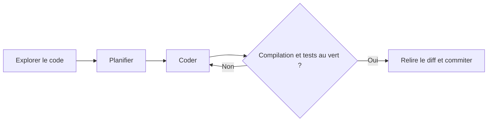

# Séance 2 — Contexte et boucle agentique

**Jeudi 3 décembre · 3 heures**

## Objectifs

À la fin de la séance, vous pouvez :

- donner à un agent le **bon contexte** : fichier d'instructions du projet, fichiers référencés, documentation à jour ;
- savoir quand **repartir d'une nouvelle session** plutôt que d'allonger la conversation ;
- suivre la séquence **explorer → planifier → coder → vérifier** ;
- donner à l'agent **un moyen de vérifier son propre travail** (compilation, tests) et travailler en **TDD** avec lui.

## Avant la séance

Installez **VS Code** avec les extensions **C# Dev Kit** et **GitHub Copilot Chat**, puis ouvrez votre dépôt Jumelo :
VS Code propose les extensions recommandées. Vérifiez que `Ctrl+Maj+B` compile la solution et que `F5` lance
l'application. À partir de cette séance, VS Code devient votre poste de pilotage de l'agent ; Visual Studio reste
utile pour les vues XAML.

## Déroulement

| Durée | Activité |
|---|---|
| 10 min | Retour sur la séance 1 |
| 40 min | Ingénierie du contexte : `AGENTS.md`, `.github/copilot-instructions.md`, instructions par type de fichier, gestion de la session. |
| 20 min | Explorer, planifier, coder, vérifier : le mode Plan. |
| 10 min | Pause |
| 20 min | La boucle de vérification : `dotnet build`, `dotnet test`, TDD avec un agent. |
| 70 min | **Activité** |
| 10 min | Bilan |

## Activité

1. **Avant / après.** Faites une même demande à l'agent sans fichier d'instructions. Rédigez ensuite le fichier
   d'instructions de Jumelo (conventions MVVM du cours, règles de test, commandes), recommencez la même demande dans une
   nouvelle session et comparez les deux résultats.
2. **Une fonctionnalité en TDD.** La cliente veut voir tout de suite les offres qui conviennent à l'étudiant choisi.
   Faites d'abord écrire les tests du ViewModel, vérifiez qu'ils échouent, puis laissez l'agent coder jusqu'à ce qu'ils
   passent.
3. Lancez l'application et vérifiez le résultat à l'écran : des tests verts ne garantissent pas que l'interface est
   correcte.
4. Un commit par étape, avec la section « Utilisation de l'IA » remplie dans la pull request.

## Notions à retenir

- La qualité du résultat dépend surtout de **ce que l'agent voit**, plus que de la tournure de la demande.
- Le contexte est une ressource limitée : une longue session se dégrade.
- Le levier le plus puissant : un critère de réussite que l'agent peut vérifier lui-même.
- Ce que l'agent ne peut pas observer (une vue WPF, une erreur de binding), c'est à vous de le vérifier.
