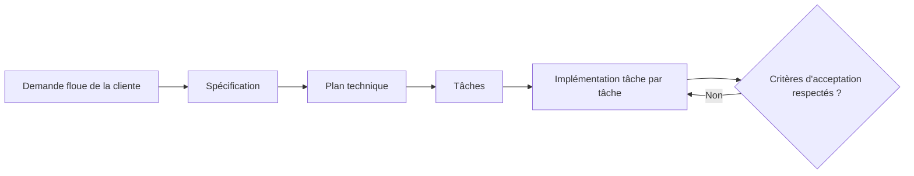

# Séance 3 — Développement guidé par la spécification

**Lundi 7 décembre · 3 heures**

## Objectifs

À la fin de la séance, vous pouvez :

- distinguer le code « au feeling » (*vibe coding*) d'un développement **guidé par une spécification**, et savoir quand
  chacun convient ;
- rédiger une spécification : récits utilisateur, **critères d'acceptation**, cas limites, ce qui est hors portée ;
- vous faire **interviewer par l'IA** pour compléter une demande floue ;
- passer de la spécification au **plan**, puis aux **tâches**, puis au code, avec GitHub Spec Kit.

## Avant la séance

Terminez la fonctionnalité commencée à la séance 2 et poussez-la dans votre dépôt. **GitHub Spec Kit** est installé
en début de séance.

## Déroulement

| Durée | Activité |
|---|---|
| 20 min | Au feeling ou avec une spec ? Ce qu'une spécification révèle avant qu'on écrive du code. |
| 20 min | Anatomie d'une spécification. |
| 30 min | Démonstration : interview par l'IA, puis spec, plan et tâches avec Spec Kit. |
| 10 min | Pause |
| 90 min | **Activité en équipe de deux** |
| 10 min | Bilan et travail à terminer |

## Activité

Dans son courriel, la cliente aimerait que les étudiants donnent **leurs trois choix préférés** et que Jumelo propose
**un jumelage pour tout le monde d'un coup**. Elle ne sait pas comment ça devrait marcher quand deux étudiants veulent
la même place.

1. Rédigez la **constitution** du projet : les règles que toute implémentation doit respecter (MVVM, tests, clean code).
2. Faites-vous interviewer par l'IA, puis rédigez la **spécification**. Chaque décision d'affaires que vous prenez
   (égalités, choix incompatibles, offres comblées, droit de la cliente de modifier la proposition) doit y être écrite.
3. Faites **réviser votre spécification par une autre équipe** avant de produire le plan.
4. Produisez le plan et les tâches, puis implémentez **tâche par tâche**, avec un commit et des tests à chaque étape.

À terminer avant la séance 4.

## Notions à retenir

- Une spécification oblige à prendre les décisions d'affaires ; sans elle, l'IA les prend à votre place, sans vous le
  dire.
- Un critère d'acceptation est vérifiable : on peut en faire un test.
- La spécification est le contrat entre la cliente, vous et l'agent. Quand le besoin change, on modifie la spec
  d'abord.
